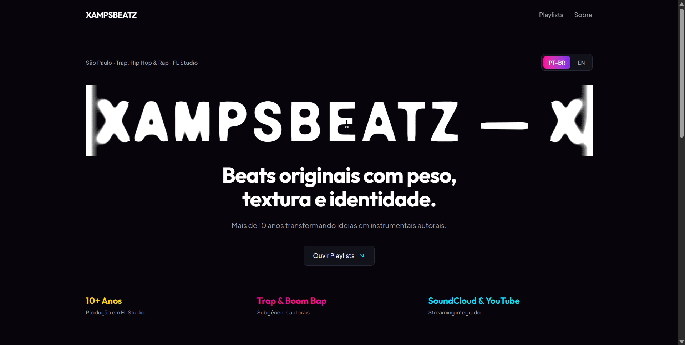

# XAMPSBEATZ

[](https://react.dev/)
[](https://www.typescriptlang.org/)
[](https://vite.dev/)
[](https://tailwindcss.com/)
[](https://xampsdev.github.io/xampsbeatz/)



*Prévia animada destacando o efeito líquido customizado **"Gooey Marquee"** renderizado em React na seção Hero.*

Portfólio musical de **XAMPSBEATZ** — beatmaker e produtor especializado em **Trap, Hip Hop e Rap** com mais de 10 anos de experiência em **FL Studio**.

**[Acessar portfólio publicado →](https://xampsdev.github.io/xampsbeatz/)**

---

## Sobre o Projeto & Destaques

O projeto evoluiu de um site estático em HTML5, CSS3 e JavaScript puro para uma **Single Page Application (SPA)** modular em **React + Tailwind CSS**, focada em estética de estúdio contemporânea, alta performance e carregamento leve sob demanda.

### Identidade Visual & Funcionalidades Principais

- **Estética Futuristic Dark Studio:** Interface escura de alto contraste (`#07070B` / `#11121A`) com acentos em **Cyber Lime (`#CCFF00`)** e **Electric Cyan (`#00F0FF`)**, acompanhada pelo favicon vetorial estilizado `X` com cortes de onda sonora em `public/favicon.svg`.
- **Efeito líquido "Gooey Marquee" no Hero:** Tipografia de destaque contínua construída em CSS customizado com camadas de fusão (`mix-blend-mode: screen`, `filter: contrast(15)` e `filter: blur(0.05em)` sobre base preto/branco puro e fontes condensadas `Archivo Narrow` / `Oswald`), com fallback automático para `prefers-reduced-motion`.
- **Player híbrido e mídia sob demanda (SoundCloud / YouTube):** Arquitetura de reprodução integrada às APIs/embeds oficiais do **SoundCloud** e **YouTube** (`LiteYouTubeEmbed` preservando a thumbnail original do vídeo via `i.ytimg.com` e botão dedicado para fechar o player após o carregamento).
- **Suporte bilíngue (PT-BR / EN):** Alternância instantânea de idioma via React Context API (`LanguageContext`), sincronizando dinamicamente toda a interface e o atributo `lang` do documento.
- **Arquitetura modular e código auditado:** Componentes desacoplados em React + Tailwind CSS após auditoria completa de dead-code elimination — com remoção definitiva de assets órfãos (`abstract-rainbow-glitch.webp`), estilos legados (`.masked-text`, `artwork-pan`), fontes/tokens CSS não utilizados e limpeza automática de `IntersectionObserver` e listeners no unmount.

---

## Fluxo de Desenvolvimento & IA Assistida

As evoluções visuais, auditorias de código e refatorações do repositório seguem um fluxo contínuo assistido por IA e CI/CD:

- **Google Gemini:** Planejamento arquitetural, especificações técnicas, auditoria de código morto e otimização de performance.
- **Google AI Studio (Build Mode):** Prototipação iterativa de UI/UX, refatoração de componentes React/TypeScript, validação em tempo real e sincronização com o repositório.
- **GitHub & GitHub Actions:** Controle de versão na branch `main` e publicação automatizada no GitHub Pages via `.github/workflows/deploy.yml`.

---

## Stack Tecnológica & Arquitetura

### Tecnologias utilizadas

| Camada | Tecnologia | Uso no projeto |
| --- | --- | --- |
| Interface | **React 18+** (`react`, `react-dom`) | Arquitetura modular de componentes funcionais e Context API. |
| Tipagem | **TypeScript** (`strict: true`, `noUnusedLocals`) | Segurança de tipos e checagem estrita em build (`tsc --noEmit`). |
| Bundler | **Vite** (`@vitejs/plugin-react`) | Servidor de desenvolvimento e empacotamento otimizado com `base: '/xampsbeatz/'`. |
| Estilização | **Tailwind CSS** (`@tailwindcss/vite`) | Layout responsivo Dark Studio, utilitários e tokens tipográficos. |
| Efeitos Visuais | **Filtros CSS & SVG customizados** | Física líquida do **Gooey Marquee** (`.marquee-wrapper`, `.marquee-blur`, `.marquee-clear`) e ícones vetoriais sob medida. |
| Ícones | **Lucide React** + SVGs customizados | Ícones de interface (`ArrowDownRight`, `Play`, `X`) e insígnias SoundCloud/YouTube. |
| Áudio & Vídeo | **SoundCloud / YouTube APIs & Embeds** | Reprodução oficial híbrida com carregamento preguiçoso sob clique do usuário. |

### Estrutura de diretórios

```text
.
├── .github/
│   └── workflows/
│       └── deploy.yml          # Pipeline CI/CD para GitHub Pages
├── public/
│   ├── favicon.svg             # Favicon vetorial "X" com identidade de beatmaker
│   └── preview.gif             # Prévia animada do portfólio e do efeito Gooey Marquee
├── src/
│   ├── assets/
│   │   └── images/             # Capa fallback para o embed do YouTube
│   ├── components/
│   │   ├── icons/
│   │   │   └── BrandIcons.tsx  # Ícones SVG SoundCloud e YouTube
│   │   ├── Header.tsx          # Barra de navegação superior fixa
│   │   └── LiteYouTubeEmbed.tsx# Player YouTube sob demanda com thumbnail e fechar
│   ├── context/
│   │   └── LanguageContext.tsx # Provedor bilíngue (pt-BR / en)
│   ├── data/
│   │   └── beats.ts            # URLs oficiais de playlists/perfis e fallback
│   ├── hooks/
│   │   └── useScrollReveal.ts  # Hook IntersectionObserver com prefers-reduced-motion
│   ├── i18n/
│   │   └── translations.ts     # Dicionário tipado PT-BR e EN
│   ├── types/
│   │   └── index.ts            # Interfaces e tipos compartilhados
│   ├── App.tsx                 # Composição principal (Hero Gooey Marquee, Playlists, Sobre)
│   ├── index.css               # Tailwind CSS v4 e física CSS do Gooey Marquee
│   ├── main.tsx                # Ponto de entrada React
│   └── vite-env.d.ts           # Declarações de ambiente Vite
├── index.html                  # Metadados SEO, fontes Google Fonts e favicon SVG
├── package.json                # Dependências e scripts npm
├── tsconfig.json               # Configuração estrita do TypeScript
└── vite.config.ts              # Configuração Vite e base '/xampsbeatz/'
```

---

## Como Executar Localmente & Deploy

### Pré-requisitos

- **Node.js 22+** e **npm**

### Execução local

```bash
git clone https://github.com/xampsdev/xampsbeatz.git
cd xampsbeatz
npm install
npm run dev
```

Scripts disponíveis no `package.json`:

| Comando | Descrição |
| --- | --- |
| `npm run dev` | Inicia o servidor de desenvolvimento Vite na porta `3000`. |
| `npm run lint` | Executa a checagem estrita de tipos (`tsc --noEmit`). |
| `npm run build` | Valida o TypeScript e gera o build otimizado em `./dist` com `base: '/xampsbeatz/'`. |
| `npm run preview` | Serve localmente o build gerado em `./dist`. |

### Deploy automatizado (GitHub Pages)

O workflow `.github/workflows/deploy.yml` publica automaticamente a aplicação a cada push na branch `main` (ou disparo manual via `workflow_dispatch`):

1. Instala dependências em Node.js 22 (utilizando `npm ci` quando `package-lock.json` está presente ou `npm install` como fallback).
2. Executa `npx tsc --noEmit && npm run build`.
3. Publica `./dist` no GitHub Pages via `actions/upload-pages-artifact` e `actions/deploy-pages`.

---

## Canais & Autor

- **E-mail:** [xampsbeatz@gmail.com](mailto:xampsbeatz@gmail.com)
- **SoundCloud:** [soundcloud.com/xampsbeatz](https://soundcloud.com/xampsbeatz)
- **YouTube:** [@xampsbeatz](https://www.youtube.com/@xampsbeatz)
- **Autor:** [XAN (@xampsdev)](https://github.com/xampsdev)

Distribuído sob a [licença MIT](./LICENSE).
